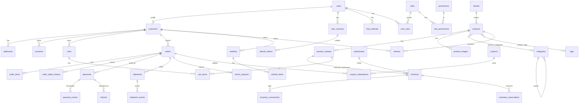
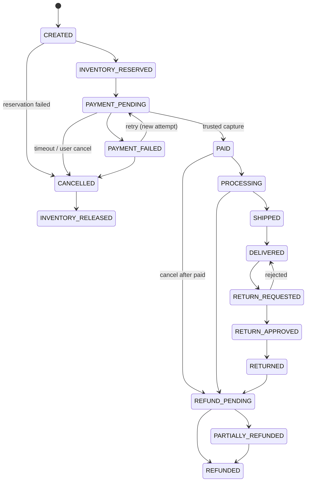

# Yalli Backend — Architecture Proposal (for review)

Status: **APPROVED (2026-11-16) — Phases 2 (foundation), 3 (security), 4 (core commerce) and 5 (checkout/payments) implemented.** See "Approved decisions & deviations" at the end.
Scope source: 91 screenshots of https://yalli.in in `reference/` (OpenCart storefront) + the master prompt.

---

## 0. What the screenshots tell us (site-parity scope)

| Observed on yalli.in | Backend capability required |
|---|---|
| Single seller "Yalli Marketing", Madurai, INR (₹), +91 phone | Single-merchant (not marketplace), INR, India payments, GST |
| 7 top-level categories (Electronics & Gadgets, Home Accessories, Kitchen & Dining, Combo, Outdoor & Travel, Health & Wellness, Yalli Products), 258 products, sub-categories | Category tree, product↔category M:N (counts overlap: 50+177+129+… > 258) |
| Product page: image, brand, "Product Code", availability, strike-through price + special price, qty, description, tags | Product, brand, SKU, price + sale price, stock status, images, tags |
| Listing: sort by, show 20/page, pagination "1 to 20 of 258" | Offset/cursor pagination, sort whitelist, page-size cap |
| Header search, `product/search`, tag search | Search abstraction (Postgres FTS first) |
| Specials, Brands, Compare, Wishlist, Sitemap | Promotions listing, brand pages, compare, wishlist |
| Guest cart ("0 item(s) – ₹0.00"), Checkout | Guest + customer cart, merge on login |
| Register: first/last name, email, **phone**, password, newsletter, captcha, privacy consent | Identity + profile, consent records, bot protection |
| Account: edit, password, address book, order history, newsletter, **Returns (RMA form)** | Profile, addresses, orders, return requests with reason enum |
| Information pages (about, delivery, privacy, terms, replacement policy), Contact form | CMS-lite pages, contact-message intake (rate-limited) |

Not visible but implied by "Amazon-style": reviews, coupons, shipments/tracking, refunds, admin console, MFA, audit.

---

## 1. Executive summary

A **NestJS modular monolith** on PostgreSQL (source of truth for money, stock, orders), Redis (cache, rate limits, short-lived state only), RabbitMQ (async side-effects via transactional outbox). Security (authN/authZ/audit) is built **first**, because it cannot be retrofitted. Commerce modules follow, scoped to site parity, then the "extra layers" (MFA hardening, reviews, analytics, courier adapters, full DevSecOps).

Key principles: deny-by-default authorization; server computes every price; money as integer paise + currency; every state change goes through an explicit state machine; every external event is idempotent; DB constraints back up application rules.

---

## 2. Technology and dependency decisions

| Concern | Choice | Why / alternative / trade-off |
|---|---|---|
| Runtime | Node.js current **LTS** (verify at Phase 2; local machine has Node 26.13, npm 11) | Pin via `.nvmrc` + `engines`. Alt: Bun/Deno — rejected, ecosystem risk for security libs. |
| Language | TypeScript `strict`, `noUncheckedIndexedAccess` | Eliminates a class of null bugs. |
| Framework | NestJS (Express adapter) | Guards/interceptors map directly to our authZ model. Fastify is faster but Passport/Helmet/raw-body webhook handling is simpler on Express; revisit if perf demands. |
| ORM | Prisma + Prisma Migrate | Type-safe; **trade-off:** weak support for CHECK/partial indexes/exclusion constraints → we hand-write SQL in migrations and use `$queryRaw` (parameterized) for `SELECT … FOR UPDATE` / conditional stock updates. |
| DB | PostgreSQL 16+ | Authoritative. Separate roles: `yalli_migrator` (DDL), `yalli_app` (DML only), `yalli_readonly` (reports). |
| Cache | Redis | Never authoritative. Used for rate limits, OTP/challenge state, catalog cache, token denylist. |
| Broker | RabbitMQ (quorum queues, DLQ, delayed retry) | Alt: BullMQ (Redis) — simpler but weaker durability; Kafka — overkill. |
| Auth | Passport (local, JWT strategies), `@node-rs/argon2` (Argon2id), `jose` for JWT, `otplib` for TOTP | No custom crypto. Access JWT **RS256/EdDSA** with `kid` for rotation. |
| Validation | `class-validator` + `class-transformer` with `whitelist` + `forbidNonWhitelisted` | Mass-assignment defence. Alt: Zod (better inference); pick one globally — **proposal: Zod via `nestjs-zod`** if you prefer single-source schemas for OpenAPI; decision needed (Q7). |
| Docs | `@nestjs/swagger` | Generated from DTOs. |
| Logging/obs | Pino (+ redaction list), `prom-client`, OpenTelemetry SDK, Grafana | Redact `authorization`, `cookie`, `password`, `token`, card-like fields. |
| Tests | Jest, Supertest, Testcontainers (Postgres/Redis/RabbitMQ), OWASP ZAP (CI baseline) | Requires Docker (not installed locally — see risks). |
| Payments | Provider adapters: **Razorpay first** (India/INR/UPI), then Stripe, PayU | See §9. |
| Storage | S3-compatible (MinIO locally, S3/R2 prod) with pre-signed uploads | Images never in Postgres. |
| Captcha | Cloudflare Turnstile or hCaptcha (server-verified) | Site has captcha on register; replaces the weak image captcha. |

All versions will be resolved and compatibility-checked at Phase 2 (`npm view`, peer-dependency check) — I will not guess versions now.

---

## 3. Directory structure

```
src/
  common/            decorators/ guards/ interceptors/ filters/ pipes/ middleware/ constants/ exceptions/ utils/(money, pagination, crypto-helpers)
  config/            env schema (validated at boot), security, database, redis, rabbitmq
  infrastructure/    database(prisma, tx helper) cache messaging(outbox publisher) storage payment(adapters) email sms captcha
  modules/
    identity/        (auth) — credentials, sessions, tokens, MFA, password reset, email/phone verification
    access/          (roles, permissions) — RBAC, policy engine, ownership checks
    customers/       profile, preferences, consents, data export/deletion
    addresses/
    catalog/         products, variants, brands, categories, images, tags, search
    inventory/       warehouses, stock levels, reservations, movements
    pricing/         price lists, sale price, coupons, campaigns, totals calculator, tax(GST)
    cart/
    checkout/        orchestrates cart→order→payment (saga, no business rules of its own)
    orders/          state machine, items snapshot, history, cancellations, invoices
    payments/        provider port, payment state machine, webhooks, reconciliation
    refunds/         + returns/RMA
    shipping/        methods, rates, shipments, tracking, courier adapters
    reviews/ wishlists/ compare/
    notifications/   templates, channels, consumers
    content/         information pages, contact messages, newsletter
    admin/           thin controllers composing other modules' services
    audit/           append-only log
    analytics/       read models
  workers/           outbox-relay, notifications, inventory-expiry, reconciliation
  app.module.ts main.ts
prisma/ schema.prisma migrations/ (+ raw SQL for CHECKs, partial indexes)
test/ unit/ integration/ e2e/ security/
docs/ architecture/ security/ api/ deployment/
infra/ docker/ nginx/ monitoring/ ci-cd/
```

Each module: `controllers/ application/ domain/ repositories/ dto/ events/ *.spec.ts`. Modules talk only through exported service interfaces and domain events — never another module's repository or Prisma tables. An ESLint boundary rule (`eslint-plugin-boundaries`) enforces this so extraction later is feasible.

Rename vs. master prompt: `auth`+`users` merged into `identity` (credentials and sessions are one aggregate); `roles`+`permissions` merged into `access`. Everything else follows the prompt.

---

## 4. Domain boundaries

| Module | Owns | Depends on | Emits |
|---|---|---|---|
| identity | users, credentials, sessions, refresh tokens, MFA, verification/reset tokens | access, audit, notifications(event) | `user.registered`, `user.login.suspicious`, `user.password.changed` |
| access | roles, permissions, role↔permission, user↔role | audit | `role.changed` |
| customers | profile, consents, preferences, export/deletion | identity | `customer.deleted` |
| catalog | products, variants, brands, categories, media | pricing(read) | `product.published`, `product.price.changed` |
| inventory | stock, reservations, movements | catalog(SKU ids) | `stock.low`, `reservation.expired` |
| pricing | prices, coupons, campaigns, tax, totals | catalog | `coupon.redeemed` |
| cart | carts/items | catalog, pricing, inventory(read) | — |
| checkout | saga/orchestration only | cart, pricing, inventory, orders, payments, addresses | — |
| orders | orders, items, status history, invoices | — | `order.created/paid/shipped/delivered/cancelled` |
| payments | payments, events, webhook inbox | orders(id only) | `payment.captured/failed/refunded` |
| refunds | refunds, returns/RMA | orders, payments | `refund.requested/completed` |
| shipping | shipments, events, rates | orders | `shipment.*` |
| notifications | templates, deliveries | — (consumer) | — |
| audit | audit_logs | — (sink) | — |

---

## 5. Database schema (summary) and ER diagram

Conventions: UUIDv7 PKs (time-ordered, index-friendly); `created_at/updated_at timestamptz`; soft-delete (`deleted_at`) only on catalog + customers; **money = `bigint` minor units (paise) + `currency char(3)`** with `CHECK (amount >= 0)`; enums as Postgres enums or lookup tables with FK.

Beyond the prompt's list I add: `brands`, `tags`, `product_tags`, `coupon_campaigns`, `tax_rates`, `consents`, `contact_messages`, `newsletter_subscriptions`, `return_requests`, `return_items`, `return_reasons`, `webhook_inbox`, `signing_keys`, `login_attempts`, `mfa_recovery_codes`, `compare_lists`, `information_pages`, `invoices`.



Critical constraints (examples, all to be in raw-SQL migrations):
- `inventory`: `CHECK (on_hand >= 0 AND reserved >= 0 AND reserved <= on_hand)`; `UNIQUE(variant_id, warehouse_id)`.
- `inventory_reservations`: `UNIQUE(order_id, variant_id, warehouse_id)`; status enum; `expires_at NOT NULL`.
- `payments`: `UNIQUE(provider, provider_payment_id)`; `UNIQUE(order_id) WHERE status IN ('CREATED','PENDING','AUTHORIZED','CAPTURED')` (one live payment per order); `captured_amount <= amount`.
- `refunds`: trigger/constraint ensuring `SUM(refunds.amount) <= payments.captured_amount`, enforced under `SELECT … FOR UPDATE` on the payment row; `UNIQUE(idempotency_key)`.
- `payment_events`, `audit_logs`, `order_status_history`, `inventory_movements`: **no UPDATE/DELETE** for `yalli_app` role (REVOKE + trigger that raises).
- `webhook_inbox`: `UNIQUE(provider, provider_event_id)`.
- `coupons`: `redeemed_count <= max_redemptions` via conditional `UPDATE … WHERE redeemed_count < max RETURNING`; `UNIQUE(coupon_id, customer_id, order_id)`.
- `reviews`: `UNIQUE(customer_id, product_id)`; `rating BETWEEN 1 AND 5`.
- `products`/`variants`: `UNIQUE(sku)` (case-insensitive via `citext` or lower index), `sale_price <= price`.
- `users`: `UNIQUE(lower(email))`, `UNIQUE(phone_e164) WHERE phone_e164 IS NOT NULL`.
- `order_items`: snapshot columns (name, sku, unit price, tax, image URL) — never joined back to live product for historical display.
- `idempotency_records`: `UNIQUE(scope, key)`, stores request hash + response; 24h TTL.
- `outbox_events`: `published_at NULL` partial index for the relay.

Full column-level spec (and generated ER image) is a Phase-1 deliverable once the entity list is approved.

---

## 6. Authentication architecture

**Identity model.** `users` (credentials, status, MFA flags) is separate from `customers` (profile, preferences). Staff are `users` without a `customers` row.

**Registration** → validate (password policy: ≥12 chars, breached-password check via k-anonymity HIBP range API, zxcvbn score) → Turnstile verify → create `users(status=PENDING_VERIFICATION)` → hash with Argon2id (m=64 MiB, t=3, p=1 as starting point, benchmarked on target hardware, params stored with hash for upgrade-on-login) → enqueue verification email (outbox) → generic response that does **not** reveal whether the email already exists (enumeration defence; duplicate attempts send a "you already have an account" email instead).

**Login** → rate limit (per IP + per account + per IP/account pair, Redis sliding window) → constant-time lookup with dummy hash when user missing → Argon2 verify → progressive lockout (5 failures → 15 min, doubling; admin-unlockable) → if MFA enabled return short-lived `mfa_challenge` (single-use, 5 min, bound to user + IP/UA hash) → create `user_session` (device label, IP, UA, `last_seen`) → issue tokens → `login_attempts` + audit; new device/geo triggers security-alert email.

**Tokens.**
- Access: JWT, **15 min**, asymmetric (EdDSA or RS256), header `kid`; claims minimal: `sub`, `sid` (session id), `iat`, `exp`, `jti`, `aud`, `iss`, `amr` (e.g. `pwd`,`otp`). **No roles/permissions/PII in token** — permissions resolved server-side per request (cached in Redis ≤60 s, busted on role change), so revocation is near-immediate.
- Refresh: 256-bit random opaque, **stored as SHA-256 hash** (high-entropy secret, so fast hash is appropriate), tied to `session_id` and a `family_id`. Rotation on every use. **Reuse detection:** presenting an already-rotated token revokes the entire family + session, audits `REFRESH_REUSE_DETECTED`, alerts the user. Absolute session lifetime (30 d) + idle timeout (7 d).
- Delivery: **web** — refresh in `HttpOnly; Secure; SameSite=Strict; Path=/api/v1/auth` cookie (`__Host-`/`__Secure-` prefix where possible), access token in memory; CSRF via double-submit signed token + `Origin` check on cookie-authenticated mutating routes. **Mobile/API clients** — refresh token in body, stored in OS keystore. Access token is never in a cookie → no CSRF on normal API calls.
- Signing keys: table `signing_keys` (kid, public key, status ACTIVE/RETIRING/RETIRED); JWKS endpoint; verification accepts ACTIVE+RETIRING; rotation runbook every 90 d. Private key from secrets manager, never DB.

**Password reset / change.** Random 256-bit token, hash stored, 30-min expiry, single use, invalidated by newer request; generic responses; on success: revoke **all** sessions, notify user. Change-password requires current password (+ MFA if enabled) and also revokes other sessions.

**MFA.** TOTP (RFC 6238) secrets encrypted at rest with AES-256-GCM using an envelope key (KMS/secret-manager KEK, per-record nonce); 10 single-use recovery codes stored Argon2id-hashed; enrollment requires confirm-code; step-up MFA required for admin login, refunds, role changes, email/phone change. MFA reset: requires recovery code, or email link + cooling-off period + notification (support staff cannot disable MFA alone — needs two-person approval). WebAuthn is a later extension (schema leaves room: `mfa_methods.type`).

**Email / phone verification.** Single-use hashed tokens (email link) / 6-digit OTP (SMS, 5 min, 5 attempts, Redis). SMS-pumping defence: per-number/IP/day caps + captcha.

**Sessions.** List/revoke own devices; "log out everywhere"; admin force-logout.

---

## 7. Authorization and RBAC matrix

**Mechanism (layered, deny-by-default):**
1. Global `JwtAuthGuard` — every route is private unless marked `@Public()`.
2. Global `PermissionsGuard` — `@RequirePermissions('products.update')`; a route with **no** permission metadata and not `@Public()`/`@Authenticated()` is rejected (startup check fails the build — tested).
3. Service-layer `PolicyService.can(actor, action, resource)` for sensitive ops (don't rely on controller guards alone).
4. **Ownership:** repositories for customer-owned resources take `customerId` from the token, never from the request, and always query `WHERE id = :id AND customer_id = :actorCustomerId`; a miss returns 404 (not 403) to avoid existence leaks. This is the BOLA control, covered by a generic parameterized negative test run over every `:id` route.
5. Privilege-escalation rules: you cannot grant a permission you don't hold; you cannot edit a role ≥ your own rank; only SUPER_ADMIN manages SUPER_ADMIN; at least 1 SUPER_ADMIN always remains; role/permission changes require step-up MFA and are audited.
6. DTOs never include `role`, `status`, `price`, `customerId` etc. on customer-facing writes (whitelist validation).

**Initial matrix** (✔ = granted; roles are additive; CUSTOMER permissions are resource-scoped "own"):

| Permission | SUPER_ADMIN | ADMIN | PRODUCT_MGR | INVENTORY_MGR | ORDER_MGR | FINANCE_MGR | SUPPORT | CUSTOMER |
|---|:-:|:-:|:-:|:-:|:-:|:-:|:-:|:-:|
| products.read | ✔ | ✔ | ✔ | ✔ | ✔ | | ✔ | public |
| products.create/update | ✔ | ✔ | ✔ | | | | | |
| products.delete | ✔ | ✔ | | | | | | |
| products.publish | ✔ | ✔ | ✔ | | | | | |
| pricing.update | ✔ | ✔ | ✔ | | | ✔ | | |
| coupons.manage | ✔ | ✔ | | | | ✔ | | |
| inventory.read | ✔ | ✔ | ✔ | ✔ | ✔ | | | |
| inventory.adjust | ✔ | ✔ | | ✔ | | | | |
| orders.read | ✔ | ✔ | | | ✔ | ✔ | ✔ | own |
| orders.update | ✔ | ✔ | | | ✔ | | | cancel own (state-permitting) |
| shipments.manage | ✔ | ✔ | | | ✔ | | | |
| payments.read | ✔ | ✔ | | | | ✔ | | own (status only) |
| refunds.create | ✔ | | | | | ✔ (+approval over threshold) | ✔ (≤ limit, request only) | request return |
| refunds.approve | ✔ | | | | | ✔ | | |
| customers.read | ✔ | ✔ | | | | | ✔ (masked PII) | own |
| customers.update | ✔ | ✔ | | | | | | own |
| customers.suspend | ✔ | ✔ | | | | | | |
| reviews.moderate | ✔ | ✔ | ✔ | | | | ✔ | |
| users.manage | ✔ | ✔ | | | | | | |
| roles.manage / permissions.manage | ✔ | | | | | | | |
| audit.read | ✔ | ✔ | | | | ✔ (financial scope) | | |
| analytics.read | ✔ | ✔ | | | | ✔ | | |

Matrix is stored in DB (seeded by migration, versioned), exported to docs, and asserted by a test so docs and code can't drift.

---

## 8. Checkout and order lifecycle

**Checkout saga (server-side, idempotent via `Idempotency-Key` header):**
1. Auth (or guest with verified email/phone) → 2. load cart → 3. validate address (pincode serviceability) → 4. re-price from catalog (ignore any client price) → 5. validate coupon(s) → 6. compute tax (GST, intra/inter-state by ship-to state; price-inclusive vs exclusive is a business decision — Q4) → 7. shipping fee → 8. total (integer paise, rounding policy documented: round-half-up per line, tax computed per line) → 9. **single DB transaction:** create `orders(CREATED)`, snapshot items/prices, reserve inventory (conditional update), redeem coupon (conditional update), write `outbox_events` → 10. create payment at provider (outside the tx, using `payments.idempotency_key`; order → `PAYMENT_PENDING`) → return provider checkout params to the client → 11. client pays on provider's hosted/tokenized UI → 12. **webhook (authoritative)** verifies signature on raw body, dedupes, fetches payment from provider API to confirm amount/currency/order, then (one tx) `payment → CAPTURED`, `order → PAID`, reservation → `COMMITTED`, outbox events. The client "success" callback only triggers a status poll; it can never mark an order paid.

**Order state machine** (invalid transitions throw; transition table in code + DB `CHECK` on allowed `(from,to)` via history trigger):



(Partial cancellation/returns operate at the `order_item` level with their own quantities; order status is derived/rolled up. Payment state machine: CREATED→PENDING→AUTHORIZED→CAPTURED, →FAILED/CANCELLED, CAPTURED→REFUND_PENDING→PARTIALLY_REFUNDED/REFUNDED; provider statuses are mapped through an adapter-specific table with unit tests.)

---

## 9. Payment architecture

`PaymentsService → PaymentProvider (port) → RazorpayAdapter | StripeAdapter | PayUAdapter`. Port methods: `createPayment`, `fetchPayment`, `verifyWebhook(rawBody, headers)`, `parseEvent`, `refund`, `fetchRefund`, `listSettlements`. **Razorpay first** (INR, UPI, cards, netbanking, COD not included) using hosted Checkout so card data never touches us (PCI scope ≈ SAQ A; no compliance claim without assessment).

Controls: raw-body capture only on the webhook route; HMAC verification with timing-safe compare and timestamp tolerance; `webhook_inbox` dedupe + replay window; process via queue (ack fast, 200 to provider after durable insert); `payment_events` immutable; refunds under `SELECT … FOR UPDATE` on the payment row with cumulative check + idempotency key; reconciliation worker nightly + every 15 min for PENDING > N min (poll provider, correct drift, alert on mismatch); no payment payload in logs (allow-list logging); payment endpoints have tighter rate limits; per-provider secrets from the secrets manager.

---

## 10. Inventory consistency strategy

PostgreSQL is authoritative. Reservation = one atomic statement:

```sql
UPDATE inventory
   SET reserved = reserved + $qty
 WHERE variant_id = $v AND warehouse_id = $w
   AND on_hand - reserved >= $qty
RETURNING *;          -- 0 rows ⇒ insufficient stock, no oversell possible
```

plus an `inventory_reservations` row (status `RESERVED`, `expires_at = now()+15m`, unique per order/variant/warehouse) in the same transaction. Commit (`RESERVED→COMMITTED`: `on_hand -= qty, reserved -= qty`), release/expire (`reserved -= qty`) are each guarded by `WHERE status = 'RESERVED'` so they're idempotent and an **expired reservation can't be committed** (commit also checks `expires_at > now()` and the late-payment path triggers refund/backorder handling). A worker sweeps expired reservations (`FOR UPDATE SKIP LOCKED`). Every change appends `inventory_movements`. A reconciliation job asserts `reserved == SUM(active reservations)` and alerts on drift. Redis may cache *display* availability only. Warehouses: schema supports many; MVP runs a single default warehouse unless you need more (Q5).

---

## 11. Threat model (STRIDE-oriented, top risks)

| # | Threat | Vector | Mitigation | Test |
|---|---|---|---|---|
| T1 | Account takeover | credential stuffing, brute force | multi-key rate limits, lockout, breached-password check, MFA, new-device alerts | brute-force + lockout tests |
| T2 | Token theft/replay | XSS, leaked refresh | short access TTL, rotating refresh, reuse detection, HttpOnly cookie, CSP | reuse-detection test |
| T3 | BOLA/IDOR | change `:id` | ownership-scoped repos, 404 on miss | generic ID-swap suite |
| T4 | BFLA / priv-esc | call admin routes, self-grant roles | deny-by-default, permission guard, rank rules | per-route negative matrix |
| T5 | Price/total tampering | client sends price | server recompute; DTO rejects price fields | tamper tests |
| T6 | Oversell / race | concurrent checkouts | atomic conditional update, constraints | concurrent-checkout test (Testcontainers) |
| T7 | Double charge/refund | retries, duplicate webhooks | idempotency keys, unique constraints, inbox dedupe | duplicate-event tests |
| T8 | Forged webhook | spoofed POST | HMAC on raw body, timestamp, provider re-fetch | forgery/replay tests |
| T9 | Coupon abuse | parallel redemption | conditional UPDATE, per-customer unique | concurrency test |
| T10 | Enumeration | register/login/reset responses | uniform responses & timing | response-diff tests |
| T11 | Injection (SQL/XSS) | free-text, search, sort params | Prisma/parameterized raw, sort/filter allow-lists, output encoding, sanitize rich text (product description is HTML on current site) | SQLi/XSS suite |
| T12 | Malicious upload | polyglot/executable image | pre-signed upload to quarantine bucket, magic-byte + size check, re-encode images, no exec content types | upload tests |
| T13 | SSRF | image-URL fetch, webhooks | no server-side fetch of user URLs; egress allow-list | n/a / review |
| T14 | Insider abuse | support/admin | least privilege, step-up MFA, approvals, masked PII, audit | audit assertions |
| T15 | DoS | large bodies, deep pagination, expensive search | body limits, timeouts, page-size cap, rate limits, query timeouts | load tests |
| T16 | Secret leakage | logs, repo | redaction, gitleaks, secrets manager | CI scan |
| T17 | SMS/email abuse | OTP pumping, contact form spam | per-target quotas, captcha | rate-limit tests |
| T18 | Supply chain | npm deps | lockfile, `npm audit`, Trivy, pinned versions, provenance | CI |

---

## 12. Security control matrix (control → where enforced → verified by)

| Control | Layer | Verified by |
|---|---|---|
| Helmet, strict CORS allow-list, HSTS | main.ts / Nginx | e2e header test |
| Global ValidationPipe whitelist | app | mass-assignment test |
| Rate limiting (Redis, per route class) | guard | rate-limit tests |
| Request size/timeouts | Nginx + Nest | oversize test |
| AuthN guard default-on | global guard | route-inventory test |
| AuthZ guard + policy service | global + service | negative matrix |
| Ownership scoping | repository | ID-swap suite |
| Idempotency | interceptor + table | duplicate tests |
| Audit append-only | DB REVOKE + trigger | UPDATE/DELETE-fails test |
| Secrets | env schema + secrets mgr | boot fails on missing/weak |
| PII encryption (TOTP secret, optionally phone/address) | app-level AES-GCM, KEK in KMS | unit tests |
| Log redaction | Pino config | log-snapshot test |
| DB least privilege | roles/migrations | integration test connecting as `yalli_app` |

---

## 13. API specification (v1, `/api/v1`) — summary

Envelope per prompt: `{success, message, data, meta, timestamp, requestId}`; errors add `error:{code,details[]}`; lists use `meta:{page,pageSize,total,…}` (cursor pagination for orders/notifications). `Idempotency-Key` required on `POST /checkout/*`, `/payments/*`, `/refunds`.

**Public:** `GET /health/{live,ready}`; `GET /catalog/categories`, `/categories/:slug`; `GET /products` (q, category, brand, minPrice, maxPrice, inStock, sort∈{default,name,price,newest,rating}, page, pageSize≤60); `GET /products/:slug`; `GET /brands`, `/brands/:slug`; `GET /products/specials`; `GET /products/:id/reviews`; `GET /content/pages/:slug`; `POST /content/contact`; `POST /content/newsletter`; `POST /webhooks/:provider` (signature-auth, not JWT); `GET /.well-known/jwks.json`.

**Auth:** `POST /auth/register|login|refresh|logout|logout-all`; `POST /auth/verify-email|resend-verification|verify-phone`; `POST /auth/forgot-password|reset-password`; `POST /auth/mfa/{enroll,confirm,verify,disable,recovery-codes/regenerate}`; `GET/DELETE /auth/sessions[/:id]`; `POST /auth/change-password`.

**Customer (own resources):** `GET/PATCH /me`; `POST /me/export`; `DELETE /me`; `GET/POST/PATCH/DELETE /me/addresses[/:id]` + `PUT /me/addresses/:id/default`; `GET/PUT /me/preferences`; cart: `GET /cart`, `POST /cart/items`, `PATCH/DELETE /cart/items/:id`, `POST /cart/coupon`, `DELETE /cart/coupon/:code`, `POST /cart/merge`; checkout: `POST /checkout/quote`, `POST /checkout/orders`; orders: `GET /orders`, `GET /orders/:id`, `POST /orders/:id/cancel`, `GET /orders/:id/invoice`, `GET /orders/:id/tracking`; payments: `POST /orders/:id/payments`, `GET /orders/:id/payments/status`; returns: `GET/POST /returns`, `GET /returns/:id`; wishlist: `GET/POST/DELETE /wishlists/...`; compare: `GET/POST/DELETE /compare`; reviews: `POST/PATCH/DELETE /products/:id/reviews`, `POST /reviews/:id/report`; notifications: `GET /me/notifications`, `PATCH …/read`.

**Admin (`/admin/*`, all permission-gated + audited):** `products`, `variants`, `categories`, `brands`, `images` (pre-signed upload), `inventory` (+`/adjust`, `/movements`), `warehouses`, `coupons`/`campaigns`, `orders` (+status transitions, notes), `shipments`, `payments` (read, reconcile), `refunds` (+`/approve`), `returns` (approve/reject), `customers` (masked; suspend/restore), `users`, `roles`, `permissions`, `reviews/moderation`, `analytics/{sales,revenue,top-products}`, `audit-logs`.

Detailed OpenAPI is generated in Phase 2+ and committed to `docs/api/`.

---

## 14. Testing strategy

Pyramid: unit (domain: pricing/rounding, coupon rules, state machines, token logic, policy) → integration (Testcontainers Postgres/Redis/RabbitMQ; repositories, transactions, outbox, webhook pipeline, provider adapters against recorded fixtures + sandbox) → e2e/Supertest (full HTTP flows) → security suite (`test/security`: every item in prompt §25, plus the auto-generated "every route has an authZ policy" and "every :id route is ownership-scoped" tests) → concurrency tests (N parallel checkouts on stock = 1; parallel coupon redemption; duplicate webhooks) → ZAP baseline in CI, full active scan nightly on staging. Coverage gate on domain/security code (≥90%), but gate on *negative tests present*, not just percentage. **I will only report tests as passing after running them.**

---

## 15. Infrastructure architecture

Docker multi-stage, distroless/non-root, read-only FS, dropped capabilities. Compose (dev/CI): app, worker, postgres, pgbouncer, redis, rabbitmq, minio, mailpit, nginx, prometheus, grafana, otel-collector, tempo/jaeger. Prod target (cloud-agnostic, k8s or ECS): app + worker as separate deployments from the same image; managed Postgres (TLS `verify-full`, PITR backups, encryption at rest), managed Redis (auth+TLS), managed RabbitMQ; Nginx/ALB for TLS 1.2+/HSTS, WAF, body limits; secrets from AWS Secrets Manager/Vault; network segmentation (DB/Redis/MQ in private subnets). `/metrics` and `/health/*` on an internal port only. Graceful shutdown + readiness gating.

## 16. CI/CD

GitHub Actions (or your CI): lint → typecheck → unit → integration (services) → e2e → `npm audit` + OSV → Semgrep → Gitleaks → build image → Trivy (fail on HIGH/CRITICAL fixable) → ZAP baseline vs. ephemeral env → push signed image → staging auto-deploy → **manual approval** → prod (protected environment, required reviewers, migrations run by `yalli_migrator` job before rollout, expand/contract migration policy). Dependabot/Renovate with security-only auto-merge off.

## 17. Implementation roadmap (mapped to site parity)

| Phase | Deliverable | Site-parity coverage |
|---|---|---|
| 1 (this doc, after approval: detailed schema + OpenAPI skeleton) | Architecture, ER, threat model | — |
| 2 Foundation | Nest/TS strict, Prisma, Compose, env validation, Pino, error envelope, health, test infra | — |
| 3 Security foundation | identity, sessions, MFA, RBAC, guards, rate limit, audit, security tests | Register, Login, Forgot password, Account/Password |
| 4 Core commerce | customers, addresses, catalog (categories/brands/products/images/search/specials), inventory, cart, pricing, coupons | Home lists, category pages, product page, search, sort/limit/pagination, cart, address book, wishlist, compare |
| 5 Checkout & money | checkout saga, orders, Razorpay, webhooks, refunds, reconciliation, outbox | Checkout, Order history, **Returns (RMA)** |
| 6 Extras | shipping/tracking, reviews, notifications, admin APIs, analytics, content pages, contact/newsletter | Info pages, Contact, Newsletter, Sitemap |
| 7 Hardening | pen-test fixes, load tests, container hardening, DR drill, runbooks | — |

Each phase ends with format → lint → tsc → tests → security review → report; no phase starts if critical security tests fail.

## 18. Known risks and trade-offs

1. **Docker, psql and Postgres are not installed on this machine.** Testcontainers/Compose need Docker (or Podman/Colima). I need you to install one before Phase 2.
2. Prisma lacks first-class CHECK/partial-index/trigger support → raw SQL migrations; risk of drift between `schema.prisma` and DB. Mitigated by a CI "migrate + `prisma db pull` diff" check.
3. Modular monolith boundaries are conventions; only lint rules enforce them. Discipline required.
4. RabbitMQ adds operational weight for a store this size; justified by your requirement, but outbox + Postgres-polling relay can run without it in dev.
5. Access JWT carries no permissions → one Redis/DB lookup per request (cached). Chosen for fast revocation over stateless purity.
6. Argon2 parameters are CPU/memory-heavy → login endpoint is a DoS target; mitigated by rate limits and a concurrency cap on hashing.
7. Product descriptions on the current site are rich HTML → stored sanitized (allow-list, e.g. `sanitize-html`) *and* escaped on output; XSS risk remains for any consumer that renders it unsafely.
8. Data migration: the existing OpenCart catalog (258 products, images) will need an import tool; scope/format not yet known.
9. GST/tax rules, invoice numbering, and COD (very common in India) materially change checkout and payments design.
10. No PCI/SOC2/GDPR/DPDP compliance is claimed; the design minimizes scope but requires formal assessment.

---

## 19. Decisions I need from you (these change the design)

| # | Question | My recommendation |
|---|---|---|
| Q1 | Payment providers for launch? | Razorpay only (INR/UPI), others behind the interface for later |
| Q2 | Cash on Delivery needed? | Decide now — COD needs its own payment state flow, fraud rules and remittance reconciliation |
| Q3 | Guest checkout allowed? | Yes with verified email/phone OTP; guest orders claimable on signup |
| Q4 | GST: prices tax-inclusive (as shown on site)? invoice numbering/GSTIN? | Inclusive prices; GST breakup computed per line; need GSTIN + state of origin |
| Q5 | Single warehouse (Madurai) or multi? | Single now, schema multi-ready |
| Q6 | Single seller confirmed (no marketplace/vendors)? | Yes |
| Q7 | Validation library: class-validator or Zod? | class-validator (Nest-native) |
| Q8 | Variants: site shows none today — build variant model now? | Yes in schema (cheap), expose in API later |
| Q9 | Where will it be hosted / which cloud? | Determines secrets manager, queue and DB choices |
| Q10 | Install Docker locally? | Required for tests |
| Q11 | Do we need an OpenCart → new DB product import? | Likely yes, Phase 4/6 |
| Q12 | SMS/email vendors (e.g. MSG91, SES)? | MSG91 + SES, behind adapters |


---

## 20. Approved decisions & deviations (2026-11-16)

**Your answers:** Q1 Razorpay only · Q2 follow the existing site (online payment only, **no COD**) · Q3 **login required to purchase** (guest carts allowed; no guest checkout; cart merges on login) · Q4 GST yes (tax-inclusive display as on site) · Q5 one warehouse, schema multi-warehouse-ready · Q6 single seller · Q9 AWS (no access yet → cloud-neutral until then) · Q10 Docker install command given · Q7/Q8/Q11/Q12 left to me.

**My choices for the "do your best" items:** validation = **Zod** (see below) · variants modelled in schema from the start, exposed later · OpenCart import = one-off CLI script in Phase 6 (needs a product export from the current store) · notifications = MSG91 (SMS) + AWS SES (email) behind adapters.

**Deviations from the proposal text, found when verifying versions (not guessed):**

| Proposal said | Implemented | Reason |
|---|---|---|
| NestJS (version unspecified) | **NestJS 12** (ESM-only; relative imports end in `.js`) | Current major; `@nestjs/*` 12 packages are ESM-only. |
| Jest | **Vitest** | Nest 12's supported test runner; Jest's ESM mode is experimental. Same Supertest/Testcontainers approach. |
| ESLint | **oxlint (type-aware)** | Nest 12 default; ESLint can be added if you want plugin rules (e.g. boundaries). |
| TypeScript latest | **TypeScript 6.0.x** | `ts-jest`/`typescript-eslint`/`@nestjs/swagger` cap at <6.1/<7; TS 7 is not yet supported by the toolchain. |
| class-validator (recommendation) | **Zod via `StandardSchemaValidationPipe`**, `.strict()` schemas | Nest 12's documented path; one library for env + DTOs; strict schemas reject unknown fields (mass-assignment). |
| Prisma (version unspecified) | **Prisma 7.10 (stable)** with `@prisma/adapter-pg` | `latest` npm tag is an 8.0 release-candidate; pinned to the stable line. |
| Node "latest LTS" | **Node >= 26** (engines) | Matches the installed runtime and Nest 12's engine range. |
| ER: `actor_id` nullable on idempotency | **NOT NULL** | Checkout is login-only; nullable columns defeat the unique constraint. |

Nest 12 also ships first-party `@nestjs/outbox`, `@nestjs/idempotency`, `@nestjs/webhooks`, `@nestjs/authentication`/`authorization`. They are **not adopted yet**: I will evaluate each against the security requirements in the phase that needs it (Phase 3 for auth/authorization, Phase 5 for outbox/idempotency/webhooks) before choosing them over the Passport + custom design above.

### Phase 3 implementation notes (2026-11-16)

- Delivered per sections 5–7; details, endpoint list, control map and open risks: `docs/security/phase-3-security-foundation.md`; flows: `docs/architecture/auth-flows.md`.
- `signing_keys` table not created: keys live in the secrets manager / env with a `kid` and a retired-public-keys list (simpler, same rotation capability).
- `login_attempts` table not created: login outcomes are recorded in `audit_logs` and counters live in Redis.
- Staff MFA is mandatory for admin APIs via step-up; staff cannot disable MFA.
- Added `consents` and `customers` tables earlier than planned because registration needs them.

### Phase 4 implementation notes (2026-11-16)

- Delivered per sections 4, 7-9, 13; invariants, endpoints, assumptions and open risks: `docs/architecture/phase-4-commerce-core.md`.
- Money columns are `integer` paise (not NUMERIC): exact, fast, and bounded by CHECK constraints; arithmetic is integer-only in code.
- Search is PostgreSQL full-text + `pg_trgm` behind `CatalogQueryService` (OpenSearch later).
- Coupon redemption is implemented (`redeemInTx`) but only exercised by checkout from Phase 5.
- Assumed: GST-inclusive prices (default 18 %), shipping ₹0 until Phase 6, one coupon per cart.

### Phase 5 implementation notes (2026-11-16)

- Delivered per sections 10-12, 24, 30; flow, invariants, runbook and open risks: `docs/architecture/phase-5-checkout-payments.md`.
- Only Razorpay is implemented (per your decision); the `PaymentProvider` port keeps Stripe/PayU additive.
- `INVENTORY_RELEASED` is not an order state (recorded as a timestamp in the same transaction). `PAYMENT_FAILED -> PAID` is legal (a later attempt on the same provider order).
- Checkout, orders, payments, refunds and returns are ONE Nest module (a single transactional unit; splitting adds only circular imports).
- Nest's first-party `@nestjs/outbox` / `idempotency` / `webhooks` packages were NOT adopted, and were not reviewed in depth: a custom outbox (lease + backoff + dedupe) and idempotency records were built instead so every guarantee is explicit and tested here. Revisit if you want less custom code to maintain.
