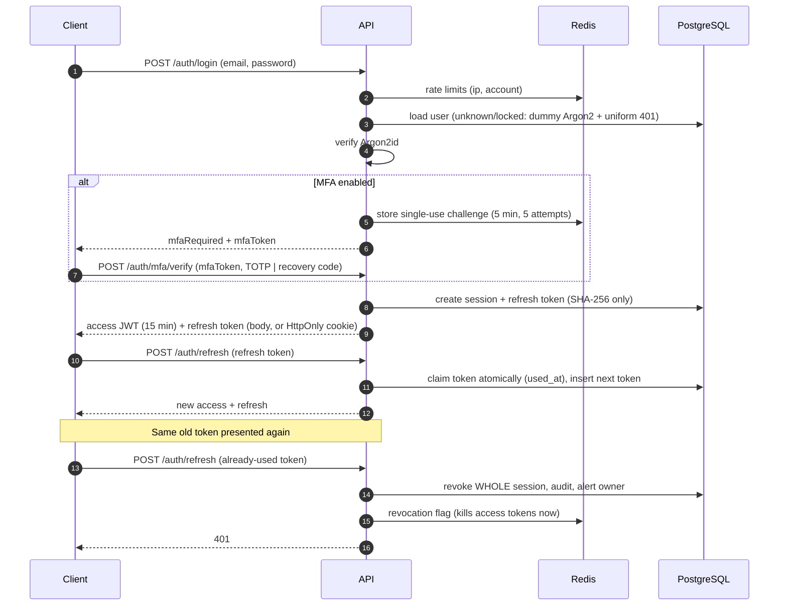
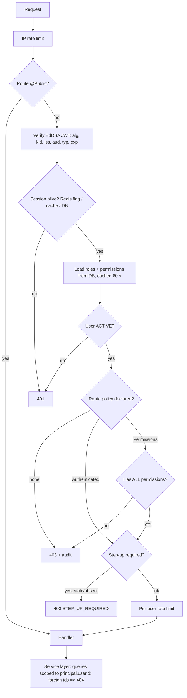

# Authentication and authorization flows (as implemented)

## Login, refresh rotation and theft detection

## Per-request authorization (deny by default)

At boot, `AccessPolicyAuditor` walks every controller route and aborts startup if any lacks `@Public`, `@Authenticated` or
`@RequirePermissions`.

## Role-change rules (`role-policy.ts`)

1. Actor needs `users.manage`; nobody may change their own roles or status.
2. SUPER_ADMIN may manage any other user.
3. Otherwise: granted/revoked role rank must be **below** the actor's rank, the target must rank below the actor, and the role may
   not carry any permission the actor lacks.
4. The last SUPER_ADMIN can never be removed (serializable transaction; conflicts return a retryable 409).
5. Every attempt, allowed or denied, is audited.
